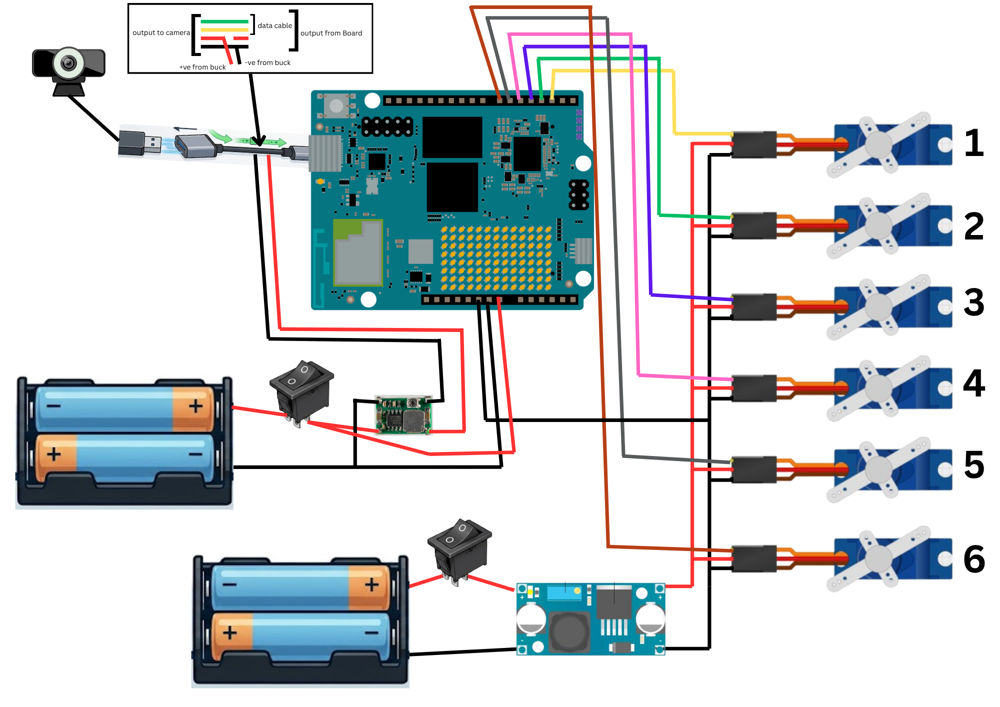

<div align="center">
  <h1>👁️ Netra-Setu</h1>
  <h3>Autonomous OCR & Tactile Braille Translation</h3>
  <p><i>Bridging the visual world with real-time, cyber-physical tactile reading.</i></p>
</div>

---

## 📖 Overview
**Netra-Setu** is an advanced, standalone embedded system designed to provide real-time, offline tactile reading for the visually impaired. Built on the dual-architecture of the **Arduino Uno Q**, the system leverages a Linux-based AI vision core to perform Optical Character Recognition (OCR). It dynamically multiplexes micro-servos through an Arduino C++ firmware to physically render a 6-dot Braille cell.

Aligning with the **Viksit Bharat** vision, this project creates an accessible, high-precision technological solution that operates entirely offline, ensuring privacy, speed, and independence for the user.

## ✨ Key Features
* **🧠 Headless Edge AI:** Runs complete PaddleOCR/Edge Impulse vision models locally without relying on cloud processing or internet connectivity.
* **⚡ RPC Bridge Architecture:** Seamless, high-speed communication between the Linux vision environment and the Arduino microcontroller.
* **🦾 Real-Time Actuation:** Drives 6 independent SG90 micro-servos to push physical Braille pins in real-time.
* **🚦 Visual Feedback Matrix:** Utilizes the onboard 13x8 LED Matrix to display the currently translated character for sighted assistants or debugging.
* **🖨️ Custom 3D Printed Mechanism:** A miniaturized, custom-designed FDM 3D-printed Braille cell mechanism to convert rotational servo movement into linear pin actuation.

---

## 🛠️ Hardware Requirements
* **Microcontroller:** Arduino Uno Q
* **Vision Sensor:** 1080p USB Webcam
* **Actuation:** 6x SG90 Micro-Servos
* **Hardware Structure:** Custom 3D Printed Braille Cell & Enclosure (PLA/PETG)

### 🖨️ 3D Printing Instructions
To replicate the physical Braille cell, navigate to the `/3D_Models` directory.

1. Print the components using **PLA or PETG** at a `0.12mm` or `0.16mm` layer height for precision.
2. The `braille_cell_base.stl` requires supports for the internal pin channels and component housing.
3. Attach the servo horns to the `push_rods.stl` and mount the 6 SG90 servos into the `servo_mount_bracket.stl`.
4. Secure the mounted servos inside the `servo_mount_holder.stl` box and align the push rods with the base.

---

## 🔌 Circuit Schematic
Here is the visual wiring diagram illustrating the connections between the Arduino Uno Q, the 6-servo multiplexing array, and the physical hardware UI:



### 🔌 Pin Mapping
| Component | Function | Arduino Digital Pin |
| :--- | :--- | :--- |
| **Servo 1** | Top Left Dot | `Pin 2` |
| **Servo 2** | Middle Left Dot | `Pin 4` |
| **Servo 3** | Bottom Left Dot | `Pin 6` |
| **Servo 4** | Top Right Dot | `Pin 3` |
| **Servo 5** | Middle Right Dot | `Pin 5` |
| **Servo 6** | Bottom Right Dot | `Pin 7` |

---

## 📁 Repository Structure

```text
Netra-Setu-Vision-Firmware/
│
├── Deploy/                             # Ready-to-run App Lab payload
│   └── Netra-Setu-Vision-Firmware.zip  # The zipped AI Core (Upload this directly to Uno Q)
│
├── 3D_Models/                   # STL files for 3D printing
│   ├── braille_cell_base.stl    # Main housing for the 6 pins, board and other components
│   ├── push_rods.stl            # Linear actuation pins
│   ├── servo_mount_bracket.stl  # Mount for the SG90 servos
│   └── servo_mount_holder.stl   # Box for mounted SG90 servos
│
├── models/                      # Compiled Edge Impulse / PaddleOCR .eim models
│
├── utils/
│   ├── __init__.py              # Package initializer
│   └── mock_dependencies.py     # Bypasses unsupported Linux audio dependencies 
│
├── headless.py                  # Main autonomous AI vision pipeline
├── web_inference.py             # Model loader and inference engine
├── netrasetu_bridge.ino         # C++ Firmware for RPC, Servos, and LED Matrix
├── app.yaml                     # Manifest for Arduino App Lab container
├── requirements.txt             # Python dependencies
└── README.md                    # Project documentation
```

---

## 🚀 How to Run

**1. Microcontroller Setup (C++ Core)**
Upload the `netrasetu_bridge.ino` sketch to the Arduino partition of the Uno Q board using the Arduino IDE.

**2. Linux Vision Setup (App Lab)**
The AI vision core is packaged as a ready-to-deploy bundle.
1. Locate the `Netra-Setu-Vision-Firmware.zip` file inside the `/Deploy` folder of this repository.
2. Upload this ZIP file **directly** into your Arduino App Lab environment. The App Lab will automatically mount the container and handle the extraction.

**3. Launch the Pipeline**
Start the application from the App Lab interface. If using the CLI over SSH, trigger the uploaded app bundle:
```bash
arduino-app-cli app start Netra-Setu-Vision-Firmware.zip
```

**4. Operation**
Place any printed text in front of the connected webcam. The system will autonomously scan, recognize the characters, display them on the LED matrix, and physically actuate the 3D-printed Braille pins.

---

## ©️ Copyright & Licensing
**Firmware for Real-Time Tactile Braille Translation and Servo Multiplexing (`netrasetu_bridge.ino`)**  
Copyright (c) 2026 Hiten Dharpure. All rights reserved.  
Software and Firmware Architecture registration filed with the Copyright Office, Government of India.